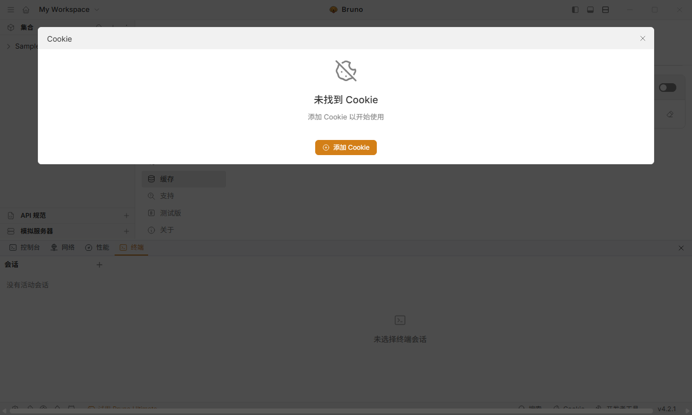
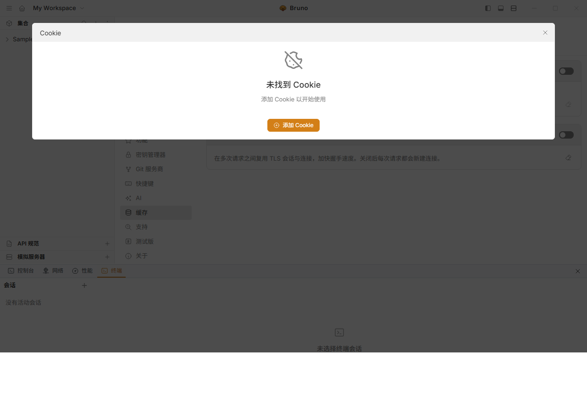

# Bruno 简体中文汉化包

把 [Bruno](https://www.usebruno.com/) API 客户端的界面汉化成简体中文。

> **适用平台：仅 Windows 10 / 11 64 位（x64）** ｜ **适用版本：仅 Bruno 4.2.1**
> 没有 macOS / Linux / Windows ARM64 版本。详见下方[平台与版本要求](#平台与版本要求必读)。

> ### ⚠️ 免责声明（请先读这段）
>
> - **非官方项目**：本项目由第三方制作，与 Bruno 官方团队（usebruno）**没有任何关联**，未获其授权或背书。
> - **不涉及授权/付费**：本项目**只替换界面显示的中文文字**，**不修改、不绕过、不规避任何授权校验**，也**不提供任何付费功能**。你的 Bruno 是什么授权状态，打上汉化后依然是什么状态。
> - **仅适用特定版本**：目前只适配 **Bruno 4.2.1 (Windows x64)**。Bruno 一旦升级，安装包结构变化，安装脚本会因哈希校验不匹配**主动拒绝执行**（不会写坏文件），需要重新适配。
> - 请自行从[官方网站](https://www.usebruno.com/downloads)下载 Bruno。本项目**不提供** Bruno 的安装程序或二进制文件。

---

## 平台与版本要求（必读）

| 项目 | 要求 |
|---|---|
| 操作系统 | **仅 Windows 10 / 11 64 位（x64）** |
| Bruno 版本 | **仅 4.2.1** |
| Bruno 安装包 | `bruno_4.2.1_x64_win.exe` 或 `bruno_4.2.1_x64_win.msi` |

**❌ 明确不支持**：

- macOS（`bruno_4.2.1_x64_mac.dmg`、`bruno_4.2.1_arm64_mac.dmg` 等）
- Linux（`bruno_4.2.1_x86_64_linux.AppImage`、`.deb`、`.rpm` 等）
- **Windows ARM64**（`bruno_4.2.1_arm64_win.exe` —— 注意文件名是 `arm64` 不是 `x64`）
- Bruno 的任何其它版本（含 4.2.1 之前和之后的版本）

> 本项目**没有** macOS / Linux / ARM 版本，也不提供。汉化包的安装脚本是
> Windows 批处理 + PowerShell，补丁清单是针对 **Windows x64 构建产物**计算出来的。
> 在不受支持的版本上运行，脚本会因 SHA-256 校验不匹配而**主动中止**（不会写坏文件），
> 但汉化也不会生效。

### 去哪里下载 Bruno 4.2.1

Bruno 请从**官方渠道**获取 —— 本项目不提供、也不再分发 Bruno 的安装程序或二进制：

- 官方下载页：<https://www.usebruno.com/downloads>
- GitHub Releases（v4.2.1）：<https://github.com/usebruno/bruno/releases/tag/v4.2.1>
  - Windows x64 安装包：**`bruno_4.2.1_x64_win.exe`**（约 116 MB）

> ⚠️ 下载时务必确认文件名里是 **`x64_win`**。同一版本下还有 `arm64_win`、`x64_mac`、
> `arm64_mac`、`x86_64_linux` 等，本汉化包**都不适用**。
>
> ⚠️ Bruno 更新很快，**一旦升级到 4.2.1 以外的版本，本汉化包即失效**，需要重新适配。

---

## 📥 下载

汉化包在 **Releases** 页面：**[→ 前往下载最新版](../../releases/latest)**

文件名：`bruno-zh-cn-4.2.1.zip`（约 240 KB，无需安装任何依赖）

---

## 效果

| 欢迎页 | 偏好设置 |
|---|---|
|  |  |

原生菜单（集合 / 编辑 / 视图 / 窗口 / 帮助）也已中文化。

---

## 安装

1. **完全退出 Bruno**（注意右下角托盘图标，右键退出）。
2. 从 [Releases](../../releases/latest) 下载 `bruno-zh-cn-4.2.1.zip` 并解压。
3. 双击 **`安装汉化.bat`**。

脚本会自动找到 Bruno 安装目录：

| 安装方式 | 典型路径 | 是否需要管理员 |
|---|---|---|
| 仅当前用户 | `%LOCALAPPDATA%\Programs\Bruno` | 不需要 |
| 所有用户 | `C:\Program Files\Bruno` | **需要**（脚本会自动弹 UAC） |

如果自动找不到，可以手动指定：

```bat
install.bat -BrunoDir "C:\Program Files\Bruno"
```

## 卸载

双击 **`卸载汉化.bat`**，会把 `app.asar` 里改动的字节**逐字节还原**，并删除翻译文件目录。

想只检查当前状态（只读，不需要管理员）：双击 **`检查汉化状态.bat`**。

---

## 它是怎么做到的

Bruno 是 Electron 应用，界面代码打包在 `resources\app.asar` 里。本汉化**不改任何业务逻辑**，只做三件事：

| 动作 | 位置 | 说明 |
|---|---|---|
| 新增文件 | `resources\bruno-zh\zh-cn.js` | 运行时翻译器（词条 + 动态规则） |
| 等长改写 | `app.asar` → `web/index.html` | 只在 `</body>` 前插入一行 `<script>`，用空格补齐到**原字节数** |
| 等长改写 | `app.asar` → `src/app/menu-template.js` | 原生菜单标签换成中文，用注释补齐到**原字节数** |

因为改写前后**字节数完全一致**，asar 的目录结构、文件偏移量、文件大小都不变：

- 不需要重新打包 253 MB 的 `app.asar`；
- 不需要安装 Node.js 或任何依赖；
- 卸载时按记录写回原始字节，可精确还原。

### 为什么不做成"正规"的 i18n 改造

Bruno 自带 `i18next`，但只有欢迎页和帮助页接了翻译（`en.json` 仅 34 行），界面有 1500+ 条硬编码英文。正规改造需要把上千处字符串包进 `t()` 再重新构建整个 monorepo，工作量和风险都很大。所以改用运行时文本替换：

- 只改 DOM 里显示的文本，以及 `placeholder` / `title` / `aria-label` 等属性；
- 用 `MutationObserver` 处理后续动态渲染的内容；
- 用保护清单（CodeMirror 编辑器、`<pre>` / `<code>`、`contenteditable` 等）**绝不触碰**请求 URL、请求体、响应体、脚本、变量值等用户数据。

---

## 词条规模

| 项目 | 数量 |
|---|---|
| 界面词条总数 | **3142** |
| 源码提取（JSX 文本 / 属性 / 对象字面量） | 2066 |
| 打包产物挖掘（bundle 里的界面文案） | 1220 |
| 人工校订 | 126 |
| 动态规则（数量、单复数、失败提示等） | 46 条正则 |

走查了欢迎页、侧边栏、集合树、工作区切换、新建请求、请求面板各页签、偏好设置全部面板、
快捷键列表、主题选择、Cookie 管理、开发者工具、新建 API 规范流程。
走查后仍为英文的只剩版本号、本地路径、代理环境变量名和用户自己起的名称 —— 均为有意保留。

---

## 自己补充 / 修改词条

翻译表是一个纯文本的 `"英文": "中文"` 映射，就在 `zh-cn.js` 里：

```js
var DICT = {
  "Send": "发送",
  "Create Collection": "创建集合",
  ...
};
```

**编辑哪一份？**

| 目的 | 改哪个 |
|---|---|
| 想立刻见效 | 改安装目录里的 `resources\bruno-zh\zh-cn.js`，保存后重启 Bruno |
| 想长期保留 | 改包里的 `payload\zh-cn.js`，然后重新执行一次 `安装汉化.bat` |

> ⚠️ 注意：如果只改了安装目录那份，之后又跑一次 `安装汉化.bat`，它会被包里的版本**覆盖**。
> 打算长期保留的修改，记得同步回包里的 `payload\zh-cn.js`。

---

## 常见问题

**Q：装完还是英文？**
确认已完全退出 Bruno 再重启。另外如果 Bruno 装在 `C:\Program Files\Bruno`，需要管理员权限才能改写 `app.asar`，双击 `安装汉化.bat` 会自动请求提权。

**Q：会不会把我的请求数据改掉？**
不会。汉化只替换界面显示文字，且有保护清单跳过所有代码编辑器、报文区域和可编辑区域。

**Q：升级 Bruno 后还能用吗？**
不能。安装脚本会校验待改写区域的 SHA-256，版本不符会**直接中止**、不会写坏文件。需要针对新版本重新适配。

**Q：能汉化别的东西吗？**
不能，只针对 Bruno，且当前只测过 4.2.1 Windows x64。

**Q：为什么有些地方还是英文？**
第三方库自带文案（CodeMirror、moment、zod 等）不在范围内。另外你自己的集合名/请求名不会被翻译（那是用户数据）。遇到漏翻可以自己往 `DICT` 里加。

---

## 目录结构

```
Bruno汉化包_4.2.1_zh-CN/
├── 安装汉化.bat            # 双击安装（需要时自动请求管理员权限）
├── 卸载汉化.bat            # 双击还原为英文
├── 检查汉化状态.bat         # 只读检查，不需要管理员权限
├── install.ps1             # 安装脚本（-BrunoDir 指定目录；-NoElevate 禁止自动提权；-Verify 只校验）
├── uninstall.ps1           # 卸载脚本
├── payload/
│   ├── zh-cn.js            # 运行时翻译器 + 词条表
│   └── patch-manifest.json # 等长补丁清单（偏移量 / 原始字节 / SHA-256）
├── 截图/                    # 界面截图
├── 验证报告.md              # 实测验证记录
└── README.md
```

---

## 许可

- 本项目的脚本与翻译器代码：**MIT**，见 [LICENSE](LICENSE)。
- Bruno 本身：**MIT**，版权归 Anoop M D, Anusree P S and Contributors 所有，见 [THIRD-PARTY-NOTICES.md](THIRD-PARTY-NOTICES.md)。
- 本汉化包中携带的少量 Bruno 原始代码（`patch-manifest.json` 中约 3.5 KB，用于校验与还原）同样遵循 MIT。

Bruno 是 usebruno 的项目，本项目与官方无关。如果你觉得 Bruno 好用，请支持官方。
